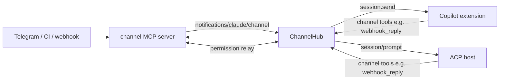

# push-adapter

Claude Code [channels](https://code.claude.com/docs/en/channels) for other agent harnesses. A channel is an MCP server that **pushes** events (chat messages, CI results, webhooks) into a running agent session, and can expose a reply tool and relay permission prompts.

push-adapter speaks the Claude channel protocol unchanged (`claude/channel` capability, `notifications/claude/channel`, `claude/channel/permission`). Existing Claude channel servers and plugins therefore work as they are. It has two front-ends:

| Front-end | Harness | How events get in |
|---|---|---|
| `copilot-extension/` | GitHub Copilot CLI / Copilot app | Copilot extension `session.send()` (enqueue or immediate) |
| `acp-host/` | Any [ACP](https://agentclientprotocol.com) agent: `copilot --acp`, `gemini --experimental-acp`, … | Host acts as the ACP client and turns events into `session/prompt` |



## Configure

Create `push-adapter.json`. The lookup order is `$PUSH_ADAPTER_CONFIG`, then `<cwd>/.github/push-adapter.json`, then `<cwd>/push-adapter.json`, then `~/.copilot/push-adapter.json`.

```jsonc
{
  "channels": {
    "webhook": { "command": "node", "args": ["./examples/webhook-channel.mjs"], "env": { "WEBHOOK_PORT": "8788" } },
    // A Claude Code plugin directory works too; it reads the plugin's .mcp.json and expands ${CLAUDE_PLUGIN_ROOT}
    "fakechat": { "plugin": "~/src/claude-plugins-official/external_plugins/fakechat", "enabled": false }
  },
  "deliveryMode": "enqueue",   // "immediate" interjects mid-turn (Copilot only)
  "permissionRelay": true
}
```

Relative args (`./`, `../`) resolve against the config file. Set `PUSH_ADAPTER_CHANNELS=a,b` to enable only those channels for one run.

## GitHub Copilot (CLI and app)

```sh
npm install
node scripts/install-copilot.mjs                 # ~/.copilot/extensions (all sessions)
node scripts/install-copilot.mjs --scope project # <repo>/.github/extensions
```

Reload extensions with `/clear` or by restarting. Pushed events appear as new user turns, and channel tools appear as `<channel>_<tool>` (e.g. `webhook_reply`). Without a config file the extension stays dormant.

## Any ACP agent

```sh
node acp-host/host.mjs -- copilot --acp
node acp-host/host.mjs --cwd ~/proj -- gemini --experimental-acp
```

- Typed lines are prompts. Events that arrive while the agent is busy are batched into the next turn.
- Permission prompts are asked locally as `[y/n]` and relayed to opted-in channels. The first answer wins.
- `--yolo` auto-approves. `--verbose` shows agent and channel stderr.
- Channel tools reach the agent as an MCP server served by the host: Streamable HTTP when the agent advertises `mcpCapabilities.http` (Copilot accepts only http/sse from ACP clients), otherwise a stdio bridge (`acp-host/tool-bridge.mjs`).

## Try it

```sh
cp push-adapter.example.json push-adapter.json
node acp-host/host.mjs -- copilot --acp      # or install the Copilot extension
curl -N localhost:8788/events                # replies + permission prompts (SSE)
curl -X POST localhost:8788 -H 'X-Sender: dev' -d 'reply PONG'
curl -X POST localhost:8788 -H 'X-Sender: dev' -d 'yes abcde'   # answer a relayed prompt
```

## Security

- **Sender gating is the channel's job.** The example webhook drops senders not in `WEBHOOK_ALLOWED_SENDERS` and returns 403. Anyone who can push can steer the agent.
- **Permission relay grants approval authority.** Only enable it for channels whose senders you trust to approve tool calls. Verdicts are accepted only for open request IDs, and only from the channels the request was sent to.
- The pushed body is escaped so it cannot close the `<channel>` tag. Meta keys are restricted to `[A-Za-z0-9_]`.
- The ACP tool endpoint binds to 127.0.0.1 and requires a random per-run bearer token.

## Limitations

- **Single owner per channel.** A PID lock (`$TMPDIR/push-adapter-locks`, overridable with `PUSH_ADAPTER_LOCK_DIR`) makes only the first session own each channel. This avoids port and bot-token clashes.
- **Copilot extension scope.** The extension attaches to the foreground session and restarts on `/clear`, which also restarts the channel servers.
- **Instructions are injected as context.** Channel instructions go in at session start or with the first event. The agent's own judgment still applies, so it may decline a request it considers unsafe.
- **Other harnesses** without ACP or an extension push API need a fallback: hooks that inject queued events as additional context (delivered on the next turn, not true push), or a blocking `wait_for_event` MCP tool.

## Development

```sh
npm test   # hub tests against the example webhook channel
```
